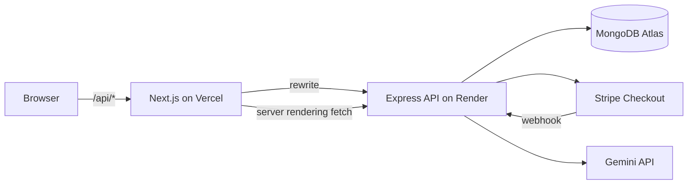
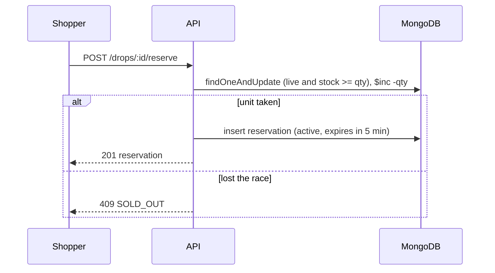
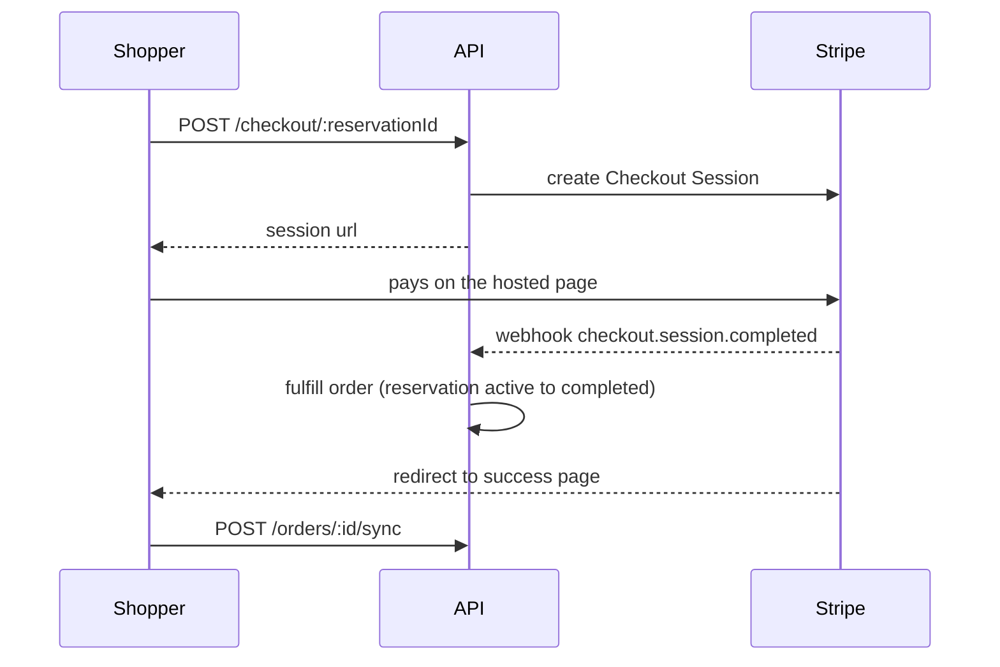

# DropCart API

Express and MongoDB backend for **DropCart**, a limited-drop store where products go on sale in scheduled, stock-limited drops.

The hard problem it solves: when many shoppers press Reserve in the same second, exactly as many succeed as there are units in stock, and nobody can ever buy a unit that is not there.


- Web app: [dropcart-client](https://github.com/tawchifulislam/dropcart-client)
- Live demo: <https://dropcart-client.vercel.app>
- API: <https://dropcart-server-5grr.onrender.com> (health check at `/health`)

## Highlights

- **Oversell-proof reservations.** Taking stock is one atomic MongoDB update. No locks, no table scans.
- **Time-boxed holds.** A reservation holds the unit for five minutes. Expired holds return their stock, both through a background sweeper and lazily when a drop looks sold out.
- **Payments behind an interface.** Stripe Checkout (hosted page) and a built-in mock provider share one fulfillment path. Webhooks are idempotent and late payments are handled safely.
- **AI shopping copilot.** Gemini function calling against the real catalog. Product cards come from tool results, never from model prose.
- **Role-based access with ownership.** `shopper`, `admin` and `superadmin`. Admins only ever see their own products, drops and revenue.
- **Operational basics.** Graceful shutdown, readiness check, rate limiting, validated environment, scripted load and payment tests, a demo reset for public deployments.

## Architecture



The browser only talks to the web app. `/api/*` is rewritten to this API, so the session cookie is first-party and no CORS setup is needed for browsers.

## The core mechanic

Reserving a unit is a single `findOneAndUpdate` whose filter checks everything at once: the drop is live and enough stock remains. If the filter matches, the decrement happens in the same operation.

```ts
const drop = await Drop.findOneAndUpdate(
  {
    _id: dropId,
    startsAt: { $lte: now },
    endsAt: { $gt: now },
    stockRemaining: { $gte: quantity },
  },
  { $inc: { stockRemaining: -quantity } },
  { new: true }
);
```

If it returns `null`, the request lost the race or the drop is not on sale. A follow-up read only decides which message to show (`SOLD_OUT`, `NOT_STARTED`, `ENDED`); it never decides who gets the unit.



Further guards:

- A partial unique index allows one **active** reservation per user per drop.
- If creating the reservation fails after stock was taken, the stock is returned in a compensating update.
- Expiry flips a reservation from `active` to `expired` with an atomic update. Only the process that wins that flip returns the stock, so a unit is never released twice.

## Payments

Hosted Stripe Checkout, with a provider interface (`src/payments`) so the rest of the code does not care which one runs.



- The order becomes `paid` in the webhook handler. The success page also calls a sync endpoint that asks the provider, so a delayed webhook does not leave the shopper waiting.
- Fulfillment is idempotent. Duplicate webhooks, or a webhook racing the sync call, fulfill exactly once.
- Sessions cannot live less than 30 minutes at Stripe, while holds last 5. When a reservation ends, the API expires the session explicitly.
- **Late payment.** If a payment arrives after the hold ended, the API tries to take the stock again. If a unit is still available the order is honored, otherwise the payment is refunded automatically.
- `PAYMENT_PROVIDER=mock` serves a simulated card page and runs the same fulfillment code. Useful for demos and tests.

## AI copilot

`POST /copilot/chat` runs a Gemini function-calling loop (at most 4 steps per message).

| Tool | Purpose |
| --- | --- |
| `searchProducts` | Keyword and price search over the real catalog |
| `listLiveDrops` | Drops that are live right now |
| `showProducts` | Tells the UI which products to render as cards |
| `addToCart` | Adds a validated product to the user's own cart |

Grounding rules: the system prompt forbids inventing products, cards are built from database rows, product ids are validated server side, and the user id always comes from the session, never from model arguments. History is stored in raw form (including Gemini thought signatures) and trimmed only on user-turn boundaries. Each user is limited to 6 messages per minute and 60 per day.

## Roles and ownership

| Role | Can do |
| --- | --- |
| `shopper` | Browse, reserve, pay, cart, copilot |
| `admin` | Manage **their own** products and drops, see their own revenue |
| `superadmin` | Everything, plus user roles and the demo reset |

Roles are read from the database on every admin request, not from the token, so demoting someone takes effect immediately. Requests for another admin's resources return `404`, so their existence is not revealed. Nobody can change their own role, which means the last superadmin cannot be removed by mistake.

## Data model

| Collection | Notes |
| --- | --- |
| `users` | name, email, password hash, role |
| `products` | name, slug, category, description, images, variants, specs, base price, owner |
| `drops` | product, start and end, drop price, `stockTotal`, `stockRemaining` |
| `reservations` | drop, user, quantity, `expiresAt`, status `active / completed / expired / released` |
| `orders` | reservation (unique), amount, provider, session and payment ids, status `pending / paid / cancelled / refunded / refund_failed` |
| `carts` | one document per user |
| `chatsessions` | display messages plus raw model history |

Prices are whole taka. Amounts are converted to minor units only when talking to Stripe.

## API reference

Auth: **Public**, **User** (any signed-in account), **Admin** (`admin` or `superadmin`), **Super** (`superadmin`).

### Account and catalog

| Method | Path | Auth | Description |
| --- | --- | --- | --- |
| POST | `/auth/register`, `/auth/login`, `/auth/logout` | Public | Session cookie auth |
| GET | `/auth/me` | User | Current account |
| GET | `/products` | Public | `search`, `category`, `page`, `limit` |
| GET | `/products/categories` | Public | Category names |
| GET | `/products/:idOrSlug` | Public | Product with its current drop |
| GET | `/drops/live`, `/drops/upcoming`, `/drops/:id` | Public | Drops with product data |

### Reservation and checkout

| Method | Path | Auth | Description |
| --- | --- | --- | --- |
| POST | `/drops/:id/reserve` | User | Atomic reservation |
| GET | `/drops/:id/reservation` | User | My active hold for a drop |
| GET | `/reservations/mine`, `/reservations/:id` | User | History and detail |
| DELETE | `/reservations/:id` | User | Release a hold |
| POST | `/checkout/:reservationId` | User | Create or resume a payment session |
| GET | `/orders/:id` | User | Order status |
| POST | `/orders/:id/sync` | User | Ask the provider and fulfill if paid |
| POST | `/orders/:id/mock-confirm` | User | Mock provider only |
| POST | `/webhooks/stripe` | Signature | Stripe events |

### Cart and copilot

| Method | Path | Auth | Description |
| --- | --- | --- | --- |
| GET | `/cart` | User | Cart with drop status |
| POST | `/cart/items` | User | Add or update an item |
| DELETE | `/cart/items/:productId` | User | Remove an item |
| POST | `/copilot/chat` | User | Rate limited |
| GET, DELETE | `/copilot/session` | User | Read or clear the conversation |

### Admin

| Method | Path | Auth | Description |
| --- | --- | --- | --- |
| GET | `/admin/overview`, `/admin/drops`, `/admin/drops/:id/stats` | Admin | Scoped dashboard data |
| POST, PUT, DELETE | `/admin/drops`, `/admin/drops/:id` | Admin | Only upcoming drops can change |
| GET, POST, PUT | `/admin/products`, `/admin/products/:id` | Admin | Scoped to the owner |
| GET | `/admin/users` | Super | Search users |
| PATCH | `/admin/users/:id/role` | Super | Change a role |
| POST | `/admin/demo/reset` | Super | Demo mode only |
| POST | `/demo/reset` | Token | Scheduled reset, demo mode only |
| GET | `/health` | Public | Readiness, checks the database connection |

Errors use one shape: `{ "error": "message", "code": "CODE", "details"?: ... }`.

## Getting started

Requirements: Node 20 or newer, a MongoDB database (Atlas free tier works).

```bash
git clone https://github.com/tawchifulislam/dropcart-server.git
cd dropcart-server
npm install
cp .env.example .env
```

Fill in `.env` (see below), then:

```bash
npm run seed
npm run dev
```

The API listens on `http://localhost:4000`. Register an account in the web app, then make yourself the first superadmin:

```bash
npm run set-role -- you@example.com superadmin
```

## Environment variables

| Name | Default | Description |
| --- | --- | --- |
| `MONGODB_URI` | none | Connection string |
| `MONGODB_DB` | `dropcart` | Database name, kept separate from the URI on purpose |
| `JWT_SECRET` | none | At least 32 characters |
| `JWT_TTL_SECONDS` | `604800` | Session lifetime |
| `PORT` | `4000` | HTTP port |
| `CLIENT_ORIGIN` | `http://localhost:3000` | Web app origin. Must be `https` in production. Used for CORS and payment redirect URLs |
| `RESERVATION_TTL_SECONDS` | `300` | How long a hold lasts |
| `PAYMENT_PROVIDER` | `mock` | `mock` or `stripe` |
| `PAYMENT_CURRENCY` | `bdt` | Currency sent to Stripe |
| `STRIPE_SECRET_KEY`, `STRIPE_WEBHOOK_SECRET` | none | Required when the provider is `stripe` |
| `GEMINI_API_KEY` | none | Enables the copilot |
| `GEMINI_MODEL` | `gemini-3.5-flash` | Model name |
| `DEMO_MODE` | `false` | Enables the demo reset endpoints |
| `DEMO_RESET_TOKEN` | none | At least 24 characters, required in demo mode |

The environment is validated at startup. A missing or invalid value stops the server with a readable message.

## Scripts

| Command | What it does |
| --- | --- |
| `npm run dev` | Start with file watching |
| `npm run build`, `npm start` | Compile and run the production build |
| `npm run typecheck` | Type check without emitting |
| `npm run seed` | Reset sample data (products, drops, demo sales) |
| `npm run set-role -- <email> <role>` | Change a user's role |
| `npm run db:reset -- --yes` | Drop the configured database (never in production) |
| `npm run load-test` | Concurrency test against a running server |
| `npm run payment-test` | Fulfillment, idempotency and late payment checks |
| `npm run copilot-test` | Grounding checks against the real model |
| `npm run gemini-check` | Diagnose Gemini access and tool declarations |

## Testing

**Concurrency.** With the server running:

```bash
npm run load-test
LOAD_TEST_BUYERS=500 LOAD_TEST_STOCK=25 npm run load-test
```

The script creates a temporary drop, fires all reservation requests at the same time using distinct signed-in users, then verifies that exactly `stock` requests got `201`, everything else got `409`, the database shows zero stock left, and exactly `stock` active holds exist. It cleans up after itself.

**Payments.** `npm run payment-test` runs against the mock provider and checks normal fulfillment, five concurrent duplicate webhooks, a late payment where stock is available, and a late payment where the unit was taken (refund).

**Copilot.** `npm run copilot-test` asks about a product that does not exist and verifies no cards appear, then checks that budget searches return only real products within budget and that add to cart really changes the cart. Model behavior is probabilistic, so read the printed replies when a check fails.

Run tests against a separate database with `MONGODB_DB=dropcart_test`. The load test needs the server and the script to use the same database.

## Deployment

Render web service, MongoDB Atlas, optional Stripe webhook.

| Setting | Value |
| --- | --- |
| Build command | `npm ci --include=dev && npm run build` |
| Start command | `npm start` |
| Health check path | `/health` |
| `NODE_ENV` | `production` |

1. Create an Atlas user limited to `readWrite` on the production database, and allow the connection from Render.
2. Set the environment variables above. Generate a new `JWT_SECRET` for production.
3. For Stripe, add a webhook endpoint at `https://<your-service>/webhooks/stripe` for `checkout.session.completed` and `checkout.session.async_payment_succeeded`, then set `STRIPE_WEBHOOK_SECRET` and `PAYMENT_PROVIDER=stripe`.
4. Seed the production database once from your machine with the production URI exported for that command only.

On Render's free plan the service sleeps after 15 minutes without traffic and takes about a minute to wake. Use a monitor that pings `/health` or a paid instance for a smooth demo.

## Demo mode

For a public demo, set `DEMO_MODE=true` and a `DEMO_RESET_TOKEN`. The sample drops are time based, so they eventually end. A scheduled GitHub Actions workflow (`.github/workflows/demo-reset.yml`) calls `POST /demo/reset` nightly, and superadmins get a "Reset demo data" button in the admin dashboard.

A reset clears orders, reservations, carts and chats, and recreates the sample products and drops. Accounts, and products created by admins, are kept. The endpoint is limited to one call per minute and returns `404` when demo mode is off.

POST /auth/guest creates a temporary guest account in demo mode. Guest accounts older than a day are deleted by the nightly reset.

## Security notes

- Session in an `httpOnly`, `Secure`, `SameSite=Lax` cookie. Responses are sent with `Cache-Control: no-store`.
- Passwords are hashed with bcrypt. Login does a hash comparison even for unknown emails.
- Every input is validated with Zod. Webhooks verify the Stripe signature against the raw body.
- Ownership is enforced in queries, not only in the UI.
- Product descriptions are written by admins and read by the model. The copilot can only read data and change the signed-in user's own cart, which limits the effect of a malicious description.

## Trade-offs and limitations

- Reservations use one atomic update instead of multi-document transactions, which keeps contention low under a rush. The cost: a crash between taking stock and creating the reservation can leak one unit. That fails safe (under-selling, never overselling).
- Rate limit counters live in memory, so they reset on restart and are not shared between instances. A shared store such as Redis would fix that.
- Product images are URLs or static paths. There is no upload pipeline yet.
- Stripe does not onboard businesses registered in every country, so payments run in test mode here and the mock provider keeps the demo usable. The provider interface is where a local gateway would plug in.
- Search is keyword based, not semantic.

## Project structure

```text
src/
  config/        environment validation, database connection
  controllers/   request handlers
  copilot/       prompt, tool declarations and executors, catalog search
  middleware/    auth and roles, errors, rate limits
  models/        Mongoose schemas
  payments/      provider interface, Stripe and mock implementations
  routes/        route tables
  schemas/       Zod input schemas
  scripts/       seed, role management, load and payment tests
  services/      reservations, payments, catalog, admin, cart, copilot, demo
  utils/         small helpers
```
