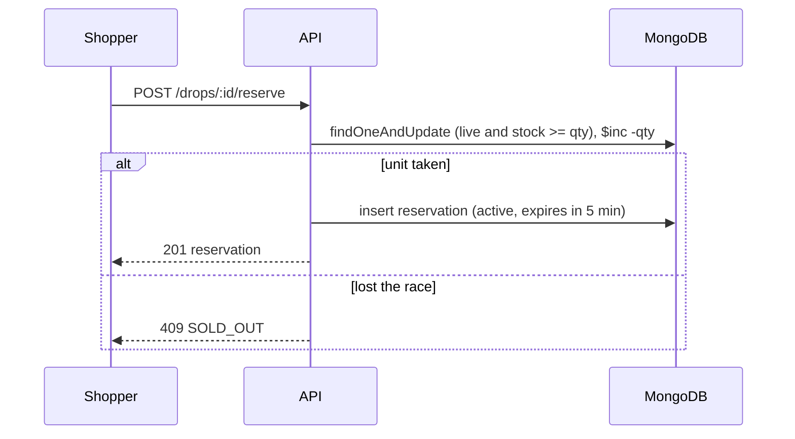
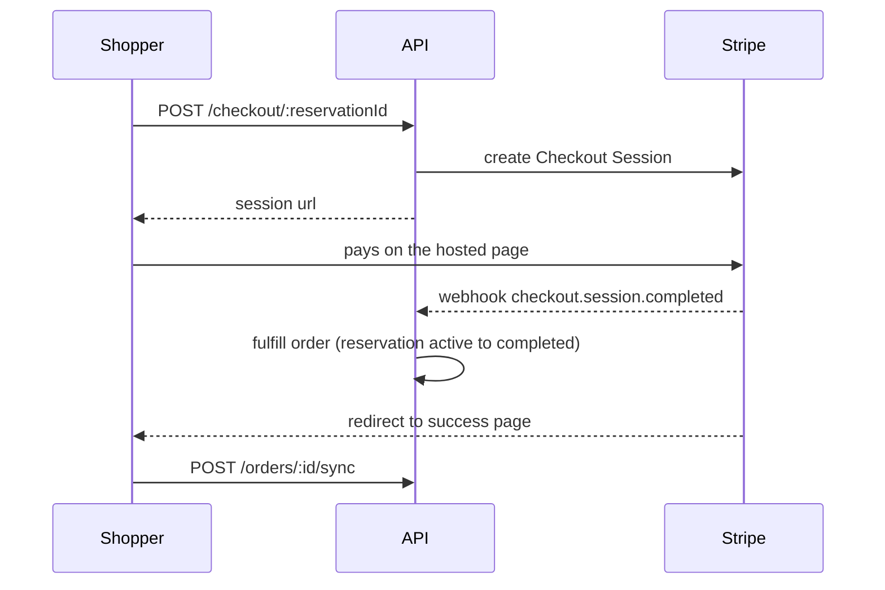

# DropCart API


**An API for limited-edition drops that cannot be oversold.** When hundreds of shoppers press Reserve in the same second, exactly as many succeed as there are units in stock, and every other request fails cleanly.

- **Live demo:** <https://dropcart-client.vercel.app> (no sign-up needed, choose "Continue as a guest")
- **Web app repository:** [dropcart-client](https://github.com/tawchifulislam/dropcart-client)
- **API:** <https://dropcart-server-5grr.onrender.com> (health check at `/health`)

> The demo runs on free hosting. If the first request is slow, the API was asleep and needs about a minute to wake up.

## Contents

- [DropCart API](#dropcart-api)
  - [Contents](#contents)
  - [Why this project](#why-this-project)
  - [Reviewer's guide](#reviewers-guide)
  - [Verified behavior](#verified-behavior)
    - [Automated tests](#automated-tests)
    - [Concurrency](#concurrency)
    - [Latency under a burst](#latency-under-a-burst)
    - [Payments and AI](#payments-and-ai)
  - [How reservations work](#how-reservations-work)
  - [Payments](#payments)
  - [AI shopping copilot](#ai-shopping-copilot)
  - [Roles and ownership](#roles-and-ownership)
  - [Tech stack](#tech-stack)
  - [Getting started](#getting-started)
    - [Prerequisites](#prerequisites)
    - [Installation](#installation)
    - [Running](#running)
    - [Testing](#testing)
  - [Deployment](#deployment)
  - [Demo mode](#demo-mode)
  - [Security notes](#security-notes)
  - [Trade-offs and next steps](#trade-offs-and-next-steps)
  - [License](#license)
  - [Author](#author)

## Why this project

Most portfolio stores stop at "add to cart". DropCart is built around a harder problem: items are scarce and many people want them at the same moment, so correctness under concurrency is the product. Around that core it covers real payments, an AI assistant that cannot invent products, role-based access with ownership, and the operational basics of running a public demo.

## Reviewer's guide

| If you want to see | Look at |
| --- | --- |
| Concurrency-safe stock handling | [`src/services/reservation.service.ts`](src/services/reservation.service.ts) |
| Idempotent payments, late payments, automatic refunds | [`src/services/payment.service.ts`](src/services/payment.service.ts) |
| Swappable payment providers | [`src/payments/`](src/payments) |
| Grounded LLM tool use | [`src/copilot/`](src/copilot) |
| Authentication, roles and ownership scoping | [`src/middleware/auth.ts`](src/middleware/auth.ts), [`src/services/scope.ts`](src/services/scope.ts) |
| Input and environment validation | [`src/schemas/`](src/schemas), [`src/config/env.ts`](src/config/env.ts) |
| Automated tests (in-memory MongoDB, run in CI) | [`tests/`](tests) |
| Scripts that run against a real database | [`src/scripts/load-test.ts`](src/scripts/load-test.ts), [`payment-test.ts`](src/scripts/payment-test.ts), [`copilot-test.ts`](src/scripts/copilot-test.ts) |

## Verified behavior

### Automated tests

`npm test` runs the Vitest suite against an in-memory MongoDB, and the same suite runs in CI on every push, together with the type check and the production build.

The suite covers:

- 200 buyers racing for 10 units, through the service and through the HTTP API
- reservation rules and expiry, including concurrent expiry sweeps and the sold-out memory
- payment fulfillment, including five simultaneous webhooks, late payments and refunds
- sessions, roles and ownership scoping
- the copilot tools, without calling the model
- the demo reset

An in-memory database does not behave exactly like a real cluster under load, so `npm run load-test` remains the end-to-end check against a real database.

### Concurrency

`npm run load-test` creates a temporary drop, fires every reservation request at the same instant using distinct signed-in users, checks the database, then sends a second wave of late arrivals at the sold-out drop. In every completed run, exactly as many reservations succeeded as there were units, no unit was oversold, stock never went negative, and every late arrival was rejected:

| Simultaneous buyers | Units in drop | Reserved (`201`) | Rejected (`409`) | Unexpected | Stock left | Active holds | Late arrivals rejected |
| ---: | ---: | ---: | ---: | ---: | ---: | ---: | ---: |
| 200 | 10 | 10 | 190 | 0 | 0 | 10 | 200 of 200 |
| 500 | 25 | 25 | 475 | 0 | 0 | 25 | 500 of 500 |

### Latency under a burst

Each row is the median of three runs after two warm-up runs, from a development machine against a hosted MongoDB Atlas free-tier cluster. The number of late arrivals equals the number of buyers in each run.

| Version | Buyers | Units | Burst p50 | Burst p95 | Burst finished in | Late arrivals p50 | Late arrivals finished in |
| --- | ---: | ---: | ---: | ---: | ---: | ---: | ---: |
| Before | 500 | 25 | 11.2 s | 13.2 s | 13.3 s | 8.9 s | 10.9 s |
| After | 200 | 10 | 2.0 s | 3.0 s | 3.1 s | 66 ms | 128 ms |

The two rows were measured at different sizes, so compare them per request rather than as totals. Dividing the finishing time by the number of requests, the burst went from about 27 ms to about 16 ms per request, and late arrivals from about 22 ms to under 1 ms per request.

What changed between the rows:

- A rejected request used to make four database round trips: an existing-hold read, the atomic attempt, an expiry sweep and a read to explain the failure. It now makes two in a burst: the atomic attempt and the explanation. The existing-hold read is gone because the unique index already guards it, and the expiry sweep on this path runs at most once every two seconds.
- Once a drop is known to be sold out, requests for it within the next second are answered from memory without touching the database. That is why late arrivals dropped by more than an order of magnitude.

These counts come from reading the request flow, not from database profiling. The free-tier database caps throughput (Atlas documents 100 operations per second for free clusters), and both versions ran at roughly 130 to 150 operations per second by that estimate, so the time per request follows the number of operations per request.

### Payments and AI

- `npm run payment-test` checks normal fulfillment, five concurrent duplicate webhooks (fulfilled once), a late payment where stock is still available (honored), and a late payment where the unit was taken (refunded).
- `npm run copilot-test` asks about a product that does not exist and verifies no product cards appear, checks that budget searches return only real products within budget, and that "add to cart" really changes the cart. Model output is probabilistic, so the script prints the replies.

## How reservations work

Reserving a unit is a single `findOneAndUpdate` whose filter checks everything at once: the drop is live and enough stock remains. If the filter matches, the decrement happens in the same operation.

```ts
const drop = await Drop.findOneAndUpdate(
  {
    _id: dropId,
    startsAt: { $lte: now },
    endsAt: { $gt: now },
    stockRemaining: { $gte: quantity },
  },
  { $inc: { stockRemaining: -quantity } },
  { returnDocument: "after" }
);
```

If it returns `null`, the request lost the race or the drop is not on sale. A follow-up read only decides which message to show (`SOLD_OUT`, `NOT_STARTED`, `ENDED`). It never decides who gets the unit.



Further guards:

- A partial unique index allows one **active** reservation per user per drop. If inserting the reservation hits that index, the unit just taken is returned to stock. An expired hold that has not been swept yet is released and the request is retried once, otherwise the answer is `ALREADY_RESERVED`.
- If creating the reservation fails for any other reason, the stock is returned in a compensating update.
- Expiry flips a reservation from `active` to `expired` with an atomic update. Only the process that wins that flip returns the stock, so a unit is never released twice. A background sweeper runs every 10 seconds, and a drop that looks sold out also triggers a lazy check.
- After a drop is proven sold out, the process remembers it for one second and rejects further requests immediately. The memory is cleared the moment stock is returned. It can only reject too eagerly, never oversell.

## Payments

Hosted Stripe Checkout, behind a provider interface so the rest of the code does not care which provider runs.



- The order becomes `paid` in the webhook handler. The success page also calls a sync endpoint that asks the provider, so a delayed webhook does not leave the shopper waiting.
- Fulfillment is idempotent. The order is claimed first with an atomic update, and only the caller that wins the claim continues, so duplicate webhooks, or a webhook racing the sync call, fulfill exactly once.
- If the process dies after the order is marked paid but before the reservation is completed, the expiry sweeper sees the paid order and completes the reservation instead of returning the unit to stock.
- Stripe sessions cannot live less than 30 minutes, while holds last 5. When a reservation ends, the API expires the session explicitly.
- **Late payment.** If a payment arrives after the hold ended, the API tries to take the stock again. If a unit is still available the order is honored, otherwise the payment is refunded automatically.
- `PAYMENT_PROVIDER=mock` serves a simulated card page and runs the same fulfillment code, which keeps the demo and the tests independent of any external account.

## AI shopping copilot

`POST /copilot/chat` runs a Gemini function-calling loop (at most 4 steps per message).

| Tool | Purpose |
| --- | --- |
| `searchProducts` | Keyword and price search over the real catalog |
| `listLiveDrops` | Drops that are live right now |
| `showProducts` | Tells the UI which products to render as cards |
| `addToCart` | Adds a validated product to the user's own cart |

Grounding rules: the system prompt forbids inventing products, cards are built from database rows, product ids are validated on the server, and the user id always comes from the session, never from model arguments. History is stored in raw form (including Gemini thought signatures) and trimmed only on user-turn boundaries. Each user is limited to 6 messages per minute and 60 per day.

## Roles and ownership

| Role | Can do |
| --- | --- |
| `shopper` | Browse, reserve, pay, cart, copilot |
| `admin` | Manage **their own** products and drops, see their own revenue |
| `superadmin` | Everything, plus user roles and the demo reset |

Roles are read from the database on every admin request, not from the token, so demoting someone takes effect immediately. Requests for another admin's resources return `404`, so their existence is not revealed. Nobody can change their own role, so the last superadmin cannot be removed by mistake.

## Tech stack

Node.js 20+, TypeScript, Express 5, MongoDB with Mongoose, Zod, JWT in `httpOnly` cookies, bcrypt, Stripe Checkout, Google Gemini (`@google/genai`), express-rate-limit. Tests use Vitest, Supertest and an in-memory MongoDB. Hosted on Render and MongoDB Atlas, with GitHub Actions for CI and the nightly demo reset.

## Getting started

### Prerequisites

Node.js 20 or newer and a MongoDB database (an Atlas free cluster works).

### Installation

```bash
git clone https://github.com/tawchifulislam/dropcart-server.git
cd dropcart-server
npm install
cp .env.example .env
```

Fill in `.env` using the variables listed below.

### Running

```bash
npm run seed
npm run dev
```

The API listens on `http://localhost:4000`. Register an account in the [web app](https://github.com/tawchifulislam/dropcart-client), then make yourself the first superadmin:

```bash
npm run set-role -- you@example.com superadmin
```

### Testing

```bash
npm test
```

The tests need no database or API keys. The first run downloads a MongoDB binary for the in-memory database.

<details>
<summary><strong>Environment variables</strong></summary>

| Name | Default | Description |
| --- | --- | --- |
| `MONGODB_URI` | none | Connection string |
| `MONGODB_DB` | `dropcart` | Database name, kept separate from the URI on purpose |
| `JWT_SECRET` | none | At least 32 characters |
| `JWT_TTL_SECONDS` | `604800` | Session lifetime |
| `PORT` | `4000` | HTTP port |
| `CLIENT_ORIGIN` | `http://localhost:3000` | Web app origin. Must be `https` in production. Used for CORS and payment redirect URLs |
| `RESERVATION_TTL_SECONDS` | `300` | How long a hold lasts |
| `PAYMENT_PROVIDER` | `mock` | `mock` or `stripe` |
| `PAYMENT_CURRENCY` | `bdt` | Currency sent to Stripe |
| `STRIPE_SECRET_KEY`, `STRIPE_WEBHOOK_SECRET` | none | Required when the provider is `stripe` |
| `GEMINI_API_KEY` | none | Enables the copilot |
| `GEMINI_MODEL` | `gemini-3.5-flash` | Model name |
| `DEMO_MODE` | `false` | Enables guest accounts and the demo reset endpoints |
| `DEMO_RESET_TOKEN` | none | At least 24 characters, required in demo mode |

The environment is validated at startup. A missing or invalid value stops the server with a readable message.

</details>

<details>
<summary><strong>Scripts</strong></summary>

| Command | What it does |
| --- | --- |
| `npm run dev` | Start with file watching |
| `npm run build`, `npm start` | Compile and run the production build |
| `npm run typecheck` | Type check the source and the tests without emitting |
| `npm test`, `npm run test:watch` | Run the automated tests once, or in watch mode |
| `npm run seed` | Reset sample data (products, drops, demo sales) |
| `npm run set-role -- <email> <role>` | Change a user's role |
| `npm run db:reset -- --yes` | Drop the configured database (never in production) |
| `npm run load-test` | Concurrency and latency test against a running server |
| `npm run payment-test` | Fulfillment, idempotency and late payment checks |
| `npm run copilot-test` | Grounding checks against the real model |
| `npm run gemini-check` | Diagnose Gemini access and tool declarations |

The load test and the other scripts need the server and the script to use the same database, so start both with the same `MONGODB_DB`. The load test reads `LOAD_TEST_BUYERS` (default 200), `LOAD_TEST_STOCK` (default 10), `LOAD_TEST_LATE` (late arrivals, defaults to the number of buyers) and `LOAD_TEST_URL`:

```bash
MONGODB_DB=dropcart_test npm run dev
MONGODB_DB=dropcart_test npm run load-test
LOAD_TEST_BUYERS=500 LOAD_TEST_STOCK=25 MONGODB_DB=dropcart_test npm run load-test
```

The script refuses to start if the API cannot see the temporary drop it creates, which is what happens when the two use different databases.

</details>

<details>
<summary><strong>API reference</strong></summary>

Auth: **Public**, **User** (any signed-in account), **Admin** (`admin` or `superadmin`), **Super** (`superadmin`).

**Account and catalog**

| Method | Path | Auth | Description |
| --- | --- | --- | --- |
| POST | `/auth/register`, `/auth/login`, `/auth/logout` | Public | Session cookie auth |
| POST | `/auth/guest` | Public | Temporary guest account, demo mode only |
| GET | `/auth/session` | Public | Current account, or `{ "user": null }`. Never an error |
| GET | `/auth/me` | User | Current account, `401` when signed out |
| GET | `/products` | Public | `search`, `category`, `page`, `limit` |
| GET | `/products/categories` | Public | Category names |
| GET | `/products/:idOrSlug` | Public | Product with its current drop |
| GET | `/drops/live`, `/drops/upcoming`, `/drops/:id` | Public | Drops with product data |

**Reservation and checkout**

| Method | Path | Auth | Description |
| --- | --- | --- | --- |
| POST | `/drops/:id/reserve` | User | Atomic reservation |
| GET | `/drops/:id/reservation` | User | My active hold for a drop |
| GET | `/reservations/mine`, `/reservations/:id` | User | History and detail |
| DELETE | `/reservations/:id` | User | Release a hold |
| POST | `/checkout/:reservationId` | User | Create or resume a payment session |
| GET | `/orders/:id` | User | Order status |
| POST | `/orders/:id/sync` | User | Ask the provider and fulfill if paid |
| POST | `/orders/:id/mock-confirm` | User | Mock provider only |
| POST | `/webhooks/stripe` | Signature | Stripe events |

**Cart and copilot**

| Method | Path | Auth | Description |
| --- | --- | --- | --- |
| GET | `/cart` | User | Cart with drop status |
| POST | `/cart/items` | User | Add or update an item |
| DELETE | `/cart/items/:productId` | User | Remove an item |
| POST | `/copilot/chat` | User | Rate limited |
| GET, DELETE | `/copilot/session` | User | Read or clear the conversation |

**Admin**

| Method | Path | Auth | Description |
| --- | --- | --- | --- |
| GET | `/admin/overview`, `/admin/drops`, `/admin/drops/:id/stats` | Admin | Scoped dashboard data |
| POST, PUT, DELETE | `/admin/drops`, `/admin/drops/:id` | Admin | Only upcoming drops can change |
| GET, POST, PUT | `/admin/products`, `/admin/products/:id` | Admin | Scoped to the owner |
| GET | `/admin/users` | Super | Search users |
| PATCH | `/admin/users/:id/role` | Super | Change a role |
| POST | `/admin/demo/reset` | Super | Demo mode only |
| POST | `/demo/reset` | Token | Scheduled reset, demo mode only |
| GET | `/health` | Public | Readiness, checks the database connection |

Errors use one shape: `{ "error": "message", "code": "CODE", "details"?: ... }`.

</details>

<details>
<summary><strong>Data model</strong></summary>

| Collection | Notes |
| --- | --- |
| `users` | name, email, password hash, role |
| `products` | name, slug, category, description, images, variants, specs, base price, owner |
| `drops` | product, start and end, drop price, `stockTotal`, `stockRemaining` |
| `reservations` | drop, user, quantity, `expiresAt`, status `active / completed / expired / released` |
| `orders` | reservation (unique), amount, provider, session and payment ids, status `pending / paid / cancelled / refunded / refund_failed` |
| `carts` | one document per user |
| `chatsessions` | display messages plus raw model history |

Prices are whole taka. Amounts are converted to minor units only when talking to Stripe.

</details>

<details>
<summary><strong>Project structure</strong></summary>

```text
src/
  config/        environment validation, database connection
  controllers/   request handlers
  copilot/       prompt, tool declarations and executors, catalog search
  middleware/    auth and roles, errors, rate limits
  models/        Mongoose schemas
  payments/      provider interface, Stripe and mock implementations
  routes/        route tables
  schemas/       Zod input schemas
  scripts/       seed, role management, load and payment tests
  services/      reservations, payments, catalog, admin, cart, copilot, demo
  utils/         small helpers
tests/           Vitest suites, shared helpers and the in-memory database setup
```

</details>

## Deployment

Render web service, MongoDB Atlas, optional Stripe webhook.

| Setting | Value |
| --- | --- |
| Build command | `npm ci --include=dev && npm run build` |
| Start command | `npm start` |
| Health check path | `/health` |
| `NODE_ENV` | `production` |

1. Create an Atlas user limited to `readWrite` on the production database, and allow the connection from Render.
2. Set the environment variables above. Generate a new `JWT_SECRET` for production.
3. For Stripe, add a webhook endpoint at `https://<your-service>/webhooks/stripe` for `checkout.session.completed` and `checkout.session.async_payment_succeeded`, then set `STRIPE_WEBHOOK_SECRET` and `PAYMENT_PROVIDER=stripe`.
4. Seed the production database once from your machine with the production URI exported for that command only.

On Render's free plan the service sleeps after 15 minutes without traffic and takes about a minute to wake. Use a monitor that pings `/health`, or a paid instance, for a smooth demo.

## Demo mode

For a public demo, set `DEMO_MODE=true` and a `DEMO_RESET_TOKEN`.

- The sample drops are time based, so they eventually end. A scheduled GitHub Actions workflow (`.github/workflows/demo-reset.yml`) calls `POST /demo/reset` nightly, and superadmins get a "Reset demo data" button in the admin dashboard.
- A reset clears orders, reservations, carts and chats, and recreates the sample products and drops. Accounts, and products created by admins, are kept. The endpoint allows one call per minute and returns `404` when demo mode is off.
- `POST /auth/guest` creates a temporary guest account so reviewers can try the store without signing up. Guest accounts older than a day are deleted by the nightly reset, and guest creation is rate limited.

## Security notes

- Session in an `httpOnly`, `Secure`, `SameSite=Lax` cookie. Responses are sent with `Cache-Control: no-store`.
- Passwords are hashed with bcrypt. Login does a hash comparison even for unknown emails.
- Every input is validated with Zod. Webhooks verify the Stripe signature against the raw body.
- Ownership is enforced in queries, not only in the UI.
- Product descriptions are written by admins and read by the model. The copilot can only read data and change the signed-in user's own cart, which limits the effect of a malicious description.

## Trade-offs and next steps

- **Atomic update instead of transactions.** Keeps contention low under a rush. The cost: a crash between taking stock and creating the reservation can leak one unit. That fails safe (under-selling, never overselling).
- **Per-process memory.** The sold-out memory and the sweep throttle live in the API process. With several instances, one could keep answering "sold out" for up to a second after another returned stock. That can only reject too eagerly, never oversell.
- **A rejected request in a burst still costs two database round trips**: the atomic attempt and the read that explains the failure. A single conditional update that also reports why it failed would remove the second one, at the price of a write on every attempt and more contention on the drop document. Not done yet.
- **The free database tier caps throughput**, so a real traffic spike on the demo would be slow regardless of the API code.
- **The test database is not a real cluster.** The automated tests use an in-memory MongoDB, so the load test against a real database stays part of the verification.
- Rate limit counters live in memory, so they reset on restart and are not shared between instances. A shared store such as Redis would fix that.
- Product images are URLs or static paths. There is no upload pipeline yet.
- Stripe does not onboard businesses registered in every country, so payments run in test mode here and the mock provider keeps the demo usable. The provider interface is where a local gateway would plug in.
- Search is keyword based, not semantic.

## License

MIT. See [LICENSE](LICENSE).

## Author

Built by [tawchifulislam](https://github.com/tawchifulislam). Questions about the design are welcome, especially about how reservations stay correct under concurrent load.
